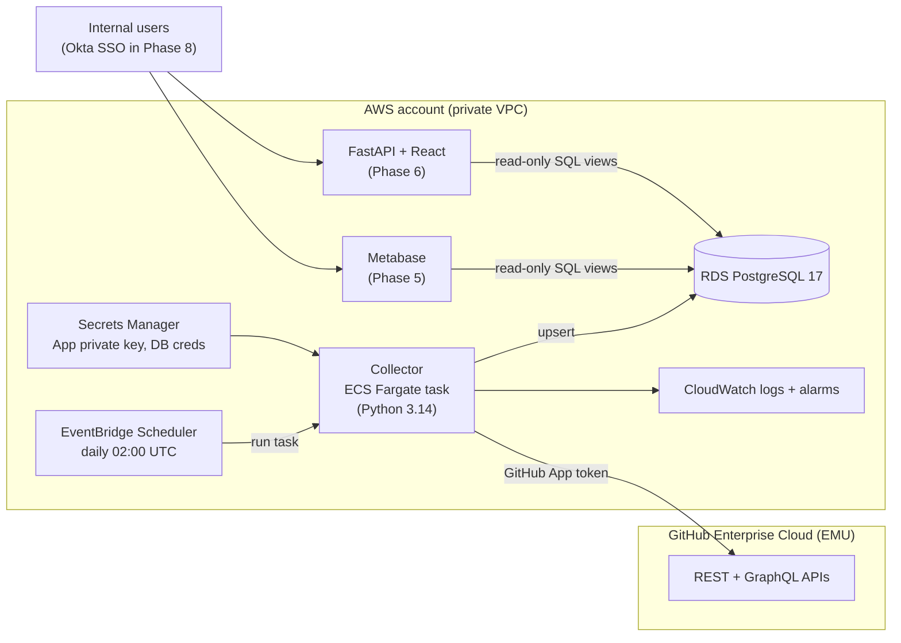
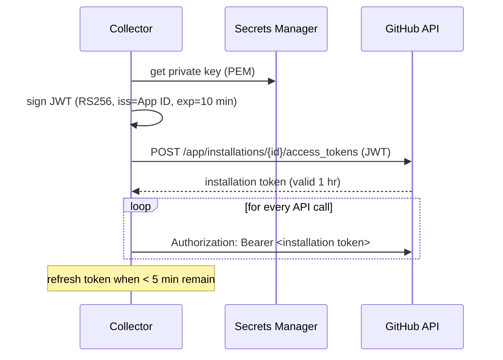
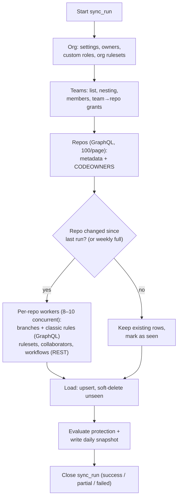
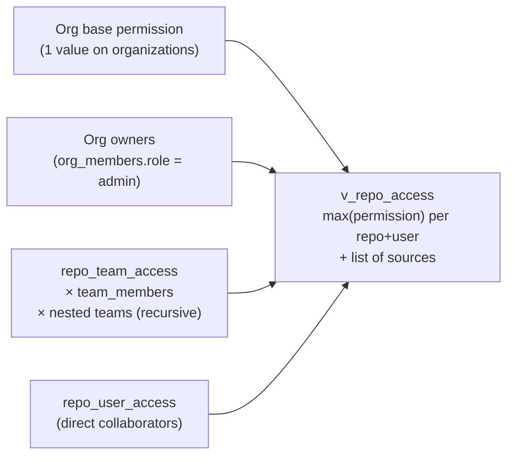
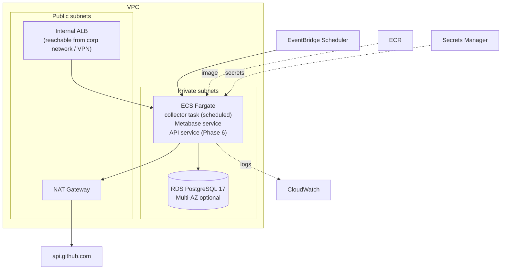

# Architecture — GitHub Repository Inventory & Auditor

| | |
|---|---|
| Status | Draft v0.1 |
| Last updated | 2026-11-01 |
| Related | [solution-design.md](solution-design.md), [implementation-guide.md](implementation-guide.md) |

## 1. Overview



Four components:

1. **GitHub App**: an identity with read-only permissions, installed on all repos in the org.
2. **Collector**: a short-lived container that authenticates as the App, pulls data, and loads it into Postgres, then exits.
3. **PostgreSQL**: the system of record, holding current state, history, and report views.
4. **Presentation**: Metabase first, a custom web app later. Both read **only from SQL views**, so report logic is defined once.

## 2. GitHub App and authentication



**Permissions (all read-only):**

| Scope | Permission | Used for |
|---|---|---|
| Repository | Metadata | Repos, branches, collaborators (always granted) |
| Repository | Contents | CODEOWNERS file, workflow files, commits |
| Repository | Administration | Classic branch protection, repo rulesets, collaborators/teams with permissions |
| Repository | Actions | Workflows and workflow runs |
| Repository | Custom properties | Future-proofing |
| Organization | Members | Teams, team membership, org owners |
| Organization | Administration | Org rulesets, org base permission, custom repository roles |

**Why an App and not a personal token:** it's tied to no person, its permissions are scoped and read-only, it gets a higher rate limit (15k/hr on GHEC), its tokens are short-lived, and its activity is auditable.

## 3. Collector design

### 3.1 Pipeline



### 3.2 API strategy and budget

GraphQL is used for bulk reads (many fields in one call), and REST where GraphQL lacks the data or where ETags make repeat calls free.

| Data | API | Approximate calls per full run |
|---|---|---|
| Repos + metadata + CODEOWNERS (3 paths) | GraphQL `organization.repositories` (100/page) | ~25–50 queries |
| Branches + head commit + matching classic rule | GraphQL `repository.refs` (100/page) | ~2,500 (batched several repos per query → ~300) |
| Classic protection rule details | GraphQL `repository.branchProtectionRules` | included above |
| Repo + inherited rulesets | REST `GET /repos/{o}/{r}/rulesets?includes_parents=true` | ~2,500 |
| Ruleset details (rules, conditions) | REST `GET /repos/{o}/{r}/rulesets/{id}` (cached by id) | ~unique rulesets |
| Direct collaborators | REST `GET /repos/{o}/{r}/collaborators?affiliation=direct` | ~2,500 |
| Workflows + latest run | REST `GET /repos/{o}/{r}/actions/workflows`, `/actions/runs?per_page=1` | ~5,000 |
| Teams, members, team repos | REST / GraphQL per team | ~2–3 × team count |

**Full run ≈ 10–13k REST calls plus a few hundred GraphQL queries.** That's within one hour of the 15k/hr limit, but too close for comfort, so the collector uses two levers:

- **ETag conditional requests:** a `304 Not Modified` response does *not* count against the rate limit. ETags are stored in the `http_cache` table, so after the first run most REST calls are free.
- **Incremental mode:** repos whose `pushed_at` and `updated_at` haven't changed skip per-repo branch and workflow calls. Access and rulesets still refresh daily, mostly as 304s. A full reconciliation runs weekly.

The collector reads `x-ratelimit-remaining` on every response and pauses when it drops below a safety floor. It honors `Retry-After` on secondary rate limits (403/429).

### 3.3 Resilience
- Work is per repository. A failure on one repo is recorded in `sync_runs.errors` and the run continues, ending with status `partial`.
- Each repo commits in its own transaction, so a crash mid-run keeps completed work. Re-running is safe because every write is an upsert.
- **Soft-delete** (setting `deleted_at`) runs only after a *successful complete* enumeration of the parent. If the repo listing fails, nothing is marked deleted.

### 3.4 Code structure (planned)

```
src/auditor/
  config.py            settings from env / Secrets Manager
  cli.py               `auditor whoami | sync | check-config | db migrate | db status`
  github/
    auth.py            JWT + installation token cache
    client.py          httpx client: retries, rate limit, ETag cache
    graphql/           .graphql query files
  collect/             one module per domain: org, teams, repos, branches,
                       protection, access, codeowners, workflows
  protection/
    rulesets.py        ruleset condition matching (fnmatch, ~DEFAULT_BRANCH, ~ALL)
    evaluate.py        effective protection + compliance per branch
  codeowners.py        CODEOWNERS parser
  load/                upserts, soft deletes, snapshots (psycopg, parameterized SQL)
  db/migrate.py        forward-only SQL migration runner
  db/views.py          rebuilds the reporting schema
db/
  migrations/          NNNN_description.sql (tables)
  views/               report views (SQL), rebuilt on every migrate
```

## 4. Data flow and freshness

| Step | When | Output |
|---|---|---|
| Collector run | Daily 02:00 UTC, plus on demand | Current-state tables updated, snapshot row per repo per day |
| Full reconciliation | Weekly (Sunday) | Every repo fully re-read, ignoring the incremental skip |
| Report refresh | On query (views are live) | Metabase / API read the views |

If view performance becomes a problem, heavy views can become *materialized views* refreshed at the end of each run. This isn't expected at this data volume.

## 5. Data model

### 5.1 Modeling principles (plain-language)

- **One table per kind of thing** (repository, branch, team, ...). Each row has a stable primary key: GitHub's own ID where available, so renames don't create duplicates.
- **Relationships through foreign keys.** A branch row points to its repository row. The database enforces that it exists.
- **Current state + history:**
  - Current-state tables are updated in place each run (*upsert* = insert, or update if it exists).
  - `first_seen_at`, `last_seen_at`, and `deleted_at` columns say when something appeared and disappeared, without physically deleting rows.
  - `repo_daily_snapshot` stores a small summary row per repo per day, which powers trend reports and "what did it look like on date X?".
- **Keep the raw payload.** A `raw jsonb` column stores GitHub's full response, so a field we didn't extract can be added later without re-fetching history.
- **Reports read views, never tables directly.** If the schema changes, only the views need updating.

### 5.2 Schema

The full schema (22 tables in `inventory` and 9 views in `reporting`), the ER diagram, and the reasoning behind it are in **[database-design.md](database-design.md)**. In short: GitHub ids as primary keys, soft deletes, a daily snapshot table for trends, and no stored derived values (whether a branch is the default or protected is computed in views).

### 5.3 Access model

Effective access is computed in the views `v_repo_access_grants` (every reason) and `v_repo_access` (highest per user), from four sources:



- **Nested teams** inherit their parent's repo access. A recursive query walks `teams.parent_team_id`.
- **Permission ranking** uses a small lookup (`read`=1 ... `admin`=5). Custom roles map to their base role.
- **Base permission and org owners are not expanded** into stored rows. The view applies them only when asked, for example "show everyone who can write to repo X, including via org base permission". The default access report shows *explicit* grants (team + direct) and notes the org-wide baseline separately. This keeps tables small.

### 5.4 Protection evaluation

For each branch, the collector computes and stores which rules apply:

1. **Classic rule:** GraphQL returns the classic rule matching each ref directly.
2. **Rulesets:** for each active ruleset that applies to the repo, its `ref_name` include/exclude conditions are matched against the branch name. `~DEFAULT_BRANCH` and `~ALL` are special tokens; other patterns use fnmatch semantics.
3. Matches are written to `branch_protection_matches` (including non-active rulesets, for visibility).
4. `v_branch_protection` derives `is_protected` / `protection_source` from active matches, and `v_default_branch_compliance` combines the matched rules (the most restrictive wins) against the rule in [solution-design.md §5](solution-design.md#5-compliance-rule-v1).

Correctness check: a sampling job compares our result with GitHub's own `GET /repos/{o}/{r}/rules/branches/{branch}` for N random branches per run, and logs mismatches.

## 6. AWS deployment



| Resource | Sizing / notes |
|---|---|
| RDS PostgreSQL 17 | `db.t4g.small`, 20 GB gp3, 7-day backups, encrypted, private |
| Collector task | 1 vCPU / 2 GB, runs about 20–60 min daily |
| Metabase service | 1 vCPU / 2 GB, always on; app DB in a separate database on the same RDS instance |
| Network | Private subnets; NAT for GitHub egress; **internal** ALB only until Okta SSO |
| Secrets | GitHub App private key, App/installation IDs, DB credentials |
| IaC | Terraform, state in S3 with locking |
| CI/CD | GitHub Actions → AWS via OIDC (no static keys): build → ECR → migrate → deploy |

Estimated monthly cost is mostly RDS, NAT, and an always-on Metabase. An approximate figure will be calculated in Phase 4.

## 7. Security

- **Least privilege:** the App is read-only. The collector's DB role can write. Metabase and the API use a separate **read-only DB role** that can only `SELECT` from views.
- **Secrets** live only in Secrets Manager, injected into the task at runtime and never baked into images or committed to git. `.pem` and `.env` files are gitignored.
- **TLS:** certificates are always verified. On the corporate network, HTTPS is decrypted by SSL inspection, so the collector trusts the company root CA (`CA_BUNDLE`) *in addition to* the public CAs. See implementation-guide §2.2.
- **Network:** no public ingress until Okta SSO is in place (Phase 8). The database is never public.
- **Data sensitivity:** the data includes user logins and access levels, which is internal-confidential. Okta SSO plus group-based authorization comes in Phase 8.
- **Audit:** `sync_runs` plus CloudWatch logs. All GitHub calls appear under the App's identity in the GitHub audit log.

## 8. Key decisions

| # | Decision | Reason |
|---|---|---|
| D1 | GitHub App instead of a PAT | Not tied to a person, read-only, 15k/hr limit, short-lived tokens |
| D2 | GraphQL for bulk, REST + ETags for the rest | Lowest API cost; 304s are free |
| D3 | Batch daily pull, not webhooks (v1) | Simpler and self-healing; webhooks optional in Phase 7 |
| D4 | Postgres with current-state + soft-delete + daily snapshot | Easy to query, keeps history without a complex temporal model |
| D5 | Reports read SQL views only | One definition shared by Metabase and the web app |
| D6 | Access stored as explicit grants; baseline applied in views | Avoids member × repo row explosion |
| D7 | Protection computed by the collector and stored per branch | Fast reports; validated against GitHub's API by sampling |
| D8 | ECS Fargate scheduled task | No servers; pay only while running; same container locally and in AWS |
| D9 | Python 3.14 + psycopg 3 (no ORM) + httpx | SQLAlchemy/Alembic are blocked by Sonatype policy (CWE-502). Plain parameterized SQL plus an in-house SQL migration runner: no extra dependency to vet, and the schema is readable as SQL |
| D10 | Metabase first, custom UI later | Value in days; the UI is built once requirements are proven |
