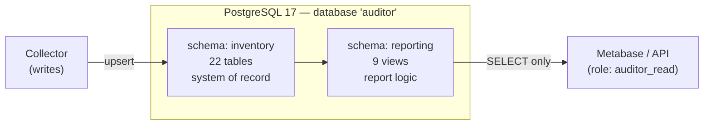
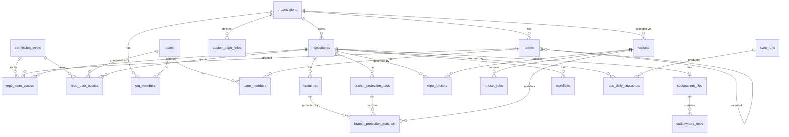

# Database Design — GitHub Repository Inventory & Auditor

| | |
|---|---|
| Status | v1 (Phase 2 delivered) |
| Last updated | 2026-11-01 |
| Source of truth | [src/auditor/db/models.py](../src/auditor/db/models.py) (tables), [db/views/](../db/views/) (reports) |
| Related | [architecture.md](architecture.md), [solution-design.md](solution-design.md) |

This document explains **what** is stored and **why** it's shaped this way. It's written for readers who are new to relational database design, so §1 covers the vocabulary first.

---

## 1. Concepts in 5 minutes

| Term | Meaning | Example here |
|---|---|---|
| **Table** | A list of one kind of thing; each **row** is one item, each **column** one attribute | `repositories`: one row per repo |
| **Primary key (PK)** | Column(s) that uniquely identify a row; never duplicated, never empty | `repositories.id` = GitHub's repo id |
| **Foreign key (FK)** | A column that points at another table's PK. The DB refuses to store a pointer to something that doesn't exist | `branches.repo_id` → `repositories.id` |
| **Unique constraint** | No two rows may share this value (or combination) | `(repo_id, name)` on `branches`: no duplicate branch names in a repo |
| **Check constraint** | A rule every row must satisfy | `visibility IN ('public','private','internal')` |
| **Index** | A lookup structure that makes searches on a column fast (like a book index) | `repositories.pushed_at` for "stale repos" |
| **Partial index** | An index or uniqueness rule that covers only some rows | Repo names are unique *among non-deleted repos* |
| **NULL** | "No value / unknown", which is different from empty or zero | `default_branch` is NULL for empty repos |
| **JSONB** | A column holding a JSON document, searchable with SQL | `raw` = GitHub's full API response |
| **Array** | A column holding a list | `topics = {python,api}` |
| **Normalization** | Store each fact **once**, in one place, and point to it instead of copying it | Team names live in `teams`; grants just reference `team_id` |
| **Schema** | A folder for tables/views inside one database | `inventory` (tables) and `reporting` (views) |
| **View** | A saved query that looks like a table. It stores no data and is computed when read | `reporting.v_repositories` |
| **Upsert** | "Insert, or update if it already exists" (`INSERT ... ON CONFLICT DO UPDATE`) | How the collector writes every run |
| **Transaction** | A group of changes that either all happen or none do | Each repo is saved in one transaction |
| **Migration** | A versioned script that changes the schema (Alembic) | `db/migrations/versions/*.py` |

---

## 2. The big picture



Three ideas shape everything:

1. **`inventory` holds facts as GitHub reports them; `reporting` holds the questions.** The tables store raw facts ("this classic rule allows force pushes"). The views compute answers ("is this default branch compliant?"). When the definition of "compliant" changes, we edit one SQL file. Stored data never needs fixing.
2. **Nothing is ever physically deleted.** A repo or branch that disappears gets `deleted_at` set. Auditors can still see what existed and when it went away.
3. **Read-only consumers can only see views.** The `auditor_read` role can read `reporting.*` and nothing in `inventory.*`. A report tool therefore can't depend on internal table structure, and can't change data.

---

## 3. Entity-relationship diagram



Read `A ||--o{ B` as "one A has zero or more Bs". `||--o|` means zero or one.

---

## 4. Tables by area

### 4.1 Common columns
Most tables carry three tracking columns, provided by the `SoftDeleted` mixin in `models.py`:

| Column | Meaning |
|---|---|
| `first_seen_at` | When the collector first saw this thing |
| `last_seen_at` | The most recent run that saw it |
| `deleted_at` | When it disappeared from GitHub (NULL = still exists) |

Don't confuse these with `created_at` / `updated_at` / `pushed_at`, which are **GitHub's** timestamps for the object.

### 4.2 Organization and people

| Table | One row per | Key points |
|---|---|---|
| `organizations` | GitHub org | `default_repository_permission` is the org-wide baseline every member gets on every repo |
| `users` | GitHub user (EMU account) | `id` is the identity; `login` can change, so it's indexed but not unique |
| `org_members` | user × org | `role = 'admin'` means **org owner**, implicitly admin on every repo |
| `teams` | team | `parent_team_id` forms a tree. Child teams inherit the parent's repo access |
| `team_members` | user × team (direct membership) | Membership via nesting is computed in views, never stored |
| `custom_repo_roles` | custom role | Each maps to a `base_role` (read…admin) so it can be ranked |
| `permission_levels` | permission level | Lookup: `none 0 < read 1 < triage 2 < write 3 < maintain 4 < admin 5` |

### 4.3 Repositories and branches

| Table | One row per | Key points |
|---|---|---|
| `repositories` | repo | PK is GitHub's repo id, so a rename updates the row instead of creating a new one. `details_synced_at` drives incremental sync. `raw` keeps the full API payload |
| `branches` | branch | GitHub branches have no id, so the PK is a generated number with `UNIQUE (repo_id, name)`. A deleted-then-recreated branch revives its old row |

**Deliberately not stored:** "is this the default branch?" and "is this branch protected?". Both can be *derived* (`branch.name = repo.default_branch`, and the protection matches), so the views compute them. A stored copy could drift out of sync; a computed value can't.

### 4.4 Branch protection
GitHub has two protection systems, and a branch can be covered by both:

| Table | Holds |
|---|---|
| `branch_protection_rules` | **Classic** rules: one pattern per rule, per repo, with every setting as a typed column |
| `rulesets` | **Rulesets** (repo, org, or enterprise level). `enforcement` = `active` / `evaluate` / `disabled`. Only `active` counts |
| `ruleset_rules` | The individual rules inside a ruleset (`pull_request`, `deletion`, `non_fast_forward`, ...), with their parameters as JSON |
| `repo_rulesets` | Which rulesets apply to which repo, including inherited org/enterprise rulesets |
| `branch_protection_matches` | **Which rule/ruleset targets which branch.** The collector computes this; each row points at exactly one classic rule *or* one ruleset (enforced by a check constraint) |

Matching patterns like `release/*` or `~DEFAULT_BRANCH` against branch names is done once by the collector, in Python. The views then only *combine* the matched rules.

### 4.5 Access ("who can touch this repo")

| Table | Holds |
|---|---|
| `repo_team_access` | Team → repo grants (`permission` = base level, `role_name` = what GitHub shows, possibly a custom role) |
| `repo_user_access` | **Direct** collaborator grants only |

**Why not one big "user × repo" table?** The org base permission gives every member access to every repo, and org owners are admin everywhere. Storing those would mean `members × repos` rows (2,000 × 2,500 = 5 million) that all say the same thing. Instead we store the *explicit* grants, and the views expand teams and owners when asked. The base permission is shown as one column (`org_base_permission`).

### 4.6 CODEOWNERS

| Table | Holds |
|---|---|
| `codeowners_files` | One row per repo once checked. `path` NULL means *checked, none found*. No row means *not checked yet* |
| `codeowners_rules` | Each parsed line: `pattern` and `owners[]` (`@user`, `@org/team`, or email) |

### 4.7 Actions, history, operations

| Table | Holds |
|---|---|
| `workflows` | Each workflow and its latest run (date, status, conclusion, runs in last 30 days) |
| `repo_daily_snapshots` | **One small row per repo per day**: compliance, counts, access summary. This powers trend charts and "what did it look like on date X?" (~900k rows/year, tiny) |
| `sync_runs` | One row per collector run: timing, counts, API usage, errors |
| `http_cache` | ETag + last response per GitHub URL. GitHub doesn't count `304 Not Modified` replies against the rate limit |

---

## 5. How the collector writes (Phase 3 preview)

For each kind of thing, every run:

```sql
-- 1. Upsert everything GitHub returned (insert new, update existing, revive deleted)
INSERT INTO inventory.branches (repo_id, name, head_sha, last_commit_at, last_seen_at)
VALUES (:repo_id, :name, :sha, :committed_at, now())
ON CONFLICT (repo_id, name) DO UPDATE
   SET head_sha = EXCLUDED.head_sha,
       last_commit_at = EXCLUDED.last_commit_at,
       last_seen_at = now(),
       deleted_at = NULL;

-- 2. Soft-delete what was NOT returned — only after the full list was read successfully
UPDATE inventory.branches
   SET deleted_at = now()
 WHERE repo_id = :repo_id AND deleted_at IS NULL AND last_seen_at < :run_started_at;
```

Then it recomputes `branch_protection_matches` for the repo (delete + insert), and at the end of the run writes one `repo_daily_snapshots` row per repo from the views. Each repo is one transaction, so a crash never leaves a repo half-written.

---

## 6. Reporting views

Views live in [db/views/](../db/views/) as plain SQL files, numbered because later views build on earlier ones. They are rebuilt automatically by every `alembic upgrade` (see §7).

| View | One row per | Answers (report #) |
|---|---|---|
| `v_branch_protection` | live branch | Protected? By what (`classic`/`ruleset`/`both`/`none`)? Effective reviews, force push, deletion settings (R4, R5) |
| `v_default_branch_compliance` | live repo | `is_compliant` plus a `failures` list, e.g. `{"no required review","force push allowed"}` (R6) |
| `v_repo_access_grants` | user × repo × reason | Every individual reason someone has access (team incl. nesting, direct, org owner) |
| `v_repo_access` | user × repo | **Effective** permission (highest wins) and readable `sources`, e.g. `team:eng via eng-backend (write)` (R7, R8) |
| `v_codeowners` | CODEOWNERS rule × owner | Owner and type (team/user/email) (R9) |
| `v_workflows` | live workflow | Last run, never-run flag (R3) |
| `v_repositories` | live repo | **Main inventory**: everything above rolled up per repo (R1, R2, R3, R9) |
| `v_daily_trends` | day | Compliance %, Actions adoption, counts over time (R10) |
| `v_sync_runs` | collector run | Duration, status, errors (R11) |

### The compliance rule
Defined in `02_v_default_branch_compliance.sql`, combining the classic rule and all *active* rulesets (most restrictive wins):

```
is_compliant = required_reviews >= 1 AND blocks_force_push AND blocks_deletion
```

Example: a classic rule requires 1 review but allows force pushes, and an org ruleset adds `non_fast_forward` + `deletion`. Together the branch is **compliant**, with source `both`. This exact case has a test.

### Example queries

```sql
-- Non-compliant, non-archived repos and why
SELECT repository, failures FROM reporting.v_default_branch_compliance
WHERE NOT is_compliant AND NOT is_archived ORDER BY repository;

-- Who can write to a repo, and why
SELECT login, effective_permission, sources FROM reporting.v_repo_access
WHERE repository = 'acme/payments-api' AND permission_rank >= 3 ORDER BY permission_rank DESC;

-- Stale repos: no push in a year, not archived
SELECT full_name, days_since_push, admin_teams FROM reporting.v_repositories
WHERE days_since_push > 365 AND NOT is_archived ORDER BY days_since_push DESC;

-- Users who are admin on the most repos (excluding org owners)
SELECT login, count(*) FROM reporting.v_repo_access
WHERE effective_permission = 'admin' AND NOT is_org_owner GROUP BY login ORDER BY 2 DESC;
```

---

## 7. Changing the schema

| Change | Steps |
|---|---|
| Add/alter a **table or column** | 1. Edit `src/auditor/db/models.py` · 2. `alembic revision --autogenerate -m "describe change"` · 3. **Review** the generated file · 4. `alembic upgrade head` · 5. Add or adjust tests |
| Add/alter a **view** | Edit or add `db/views/NN_name.sql` → `alembic upgrade head`. No migration file is needed |
| Check models and migrations agree | `alembic check` (also runs in CI) |

How upgrades work (`db/migrations/env.py`), all in **one transaction**:
1. Drop the `reporting` schema (all views).
2. Apply table migrations.
3. If at the latest version, recreate every view from `db/views/*.sql` and re-grant `auditor_read`.

Table changes therefore never get blocked by views that depend on them, and if anything fails, the whole upgrade rolls back. Downgrading below the latest version leaves the views absent until you upgrade again.

---

## 8. Roles and security

| Role | Used by | Can |
|---|---|---|
| `auditor` (owner) | Collector, migrations | Everything on `inventory` and `reporting` |
| `auditor_read` (group, NOLOGIN) | Metabase, API, via a login user granted membership | `SELECT` on `reporting.*` only |

In AWS (Phase 4), a login user such as `metabase_user` is created and granted `auditor_read`. The tables in `inventory` are not visible to it. There is a test proving this.

---

## 9. Size estimate (2,500 repos / 10k branches)

| Table | Rows (approx.) |
|---|---|
| repositories | 2.5k |
| branches | 10k |
| branch_protection_matches | ~15k |
| repo_team_access + repo_user_access | ~10–30k |
| codeowners_rules | ~10k |
| workflows | ~8k |
| repo_daily_snapshots | +2.5k/day (~900k/year) |
| http_cache | ~10k (largest by bytes, a few hundred MB at most) |

The whole database stays **well under 2 GB** for years, so `db.t4g.small` on RDS is ample. Every view runs in milliseconds at this size, and no materialized views are needed.
